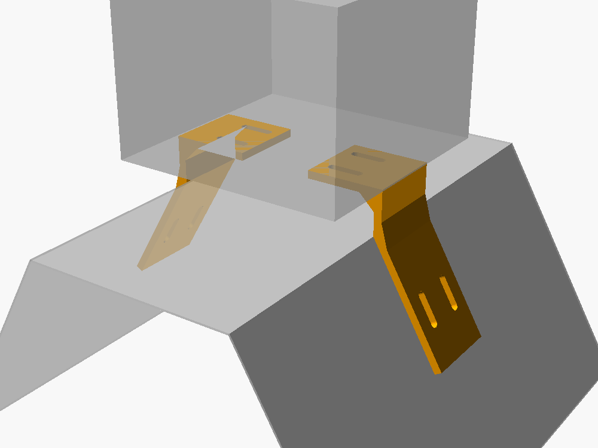
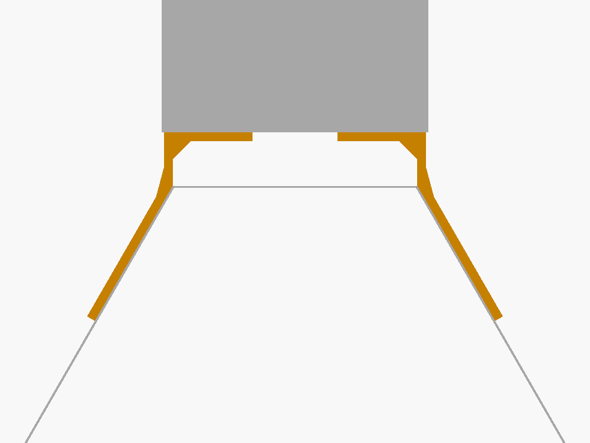

# Soporte de la caja estanca

Dos piezas iguales que sostienen la caja arriba de la trampa delta, como las
planchuelas del prototipo de referencia. **Versión de prueba: medidas
inventadas**, a reemplazar por las reales.




## Archivos

| Archivo | Qué es |
|---|---|
| `soporte_caja.scad` | Diseño paramétrico (OpenSCAD). Acá se cambian las medidas. |
| `soporte_caja.stl` | Una pieza lista para imprimir. **Imprimir 2.** |

## Medidas que necesito

| Parámetro | Qué medir | Valor de prueba |
|---|---|---|
| `angulo_lateral` | Ángulo del lateral de la trampa respecto de la horizontal | 60° |
| `ancho_techo` | Ancho del techo plano de la trampa, de lateral a lateral | 110 mm |
| `caja_ancho`, `caja_largo`, `caja_alto` | Medidas exteriores de la caja estanca | 120 × 120 × 90 mm |
| Agujeros del fondo de la caja | Si trae agujeros o resaltes para fijarla | (sin dato) |
| Material y espesor del lateral | Cartón, plástico corrugado… (para elegir el tornillo) | (sin dato) |
| Altura de cámara deseada | Depende del lente; ver `docs/hardware.md` | caja a 24 mm del techo |

Si la trampa es triangular (sin techo plano), avisame: cambia el diseño.

## Regenerar el STL

```bash
openscad -o soporte_caja.stl -D 'parte="imprimir"' soporte_caja.scad
openscad -o ensamble.png -D 'parte="ensamble"' --imgsize=1000,750 soporte_caja.scad
```

O abrir el `.scad` en OpenSCAD y usar el panel *Customizer*. La consola avisa
el hueco libre para la cámara y frena si las alas la tapan.

## Impresión

- **Material: PETG o ASA.** El PLA se deforma al sol (una caja al sol en
  Mendoza supera los 55 °C).
- El STL ya viene orientado: perfil acostado en la cama, 40 mm de alto. Así
  las capas siguen la forma de la pieza y no se parte en el codo. Sin soportes.
- 4 perímetros, 30–40 % de relleno, capa de 0.2 mm.
- Tornillos M4 con arandela ancha del lado de la trampa (el cartón o el
  plástico corrugado se rompen con la cabeza sola).

## Montaje

1. Hacer un agujero en el techo de la trampa debajo de la ventana de la cámara.
2. Atornillar las dos piezas al fondo de la caja (las ranuras dejan ajustar el ancho).
3. Apoyar sobre la trampa y atornillar las patas a los laterales.
